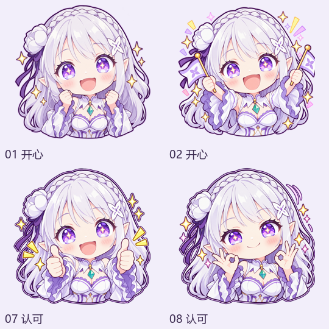

# 爱蜜莉雅 Q版表情包 · 附逐图语义描述

面向 [AstrBot 表情包管理器](https://github.com/anka-afk/astrbot_plugin_meme_manager) 的社区同人表情包，以《Re:Zero》中的爱蜜莉雅为形象，包含 **120 张透明背景 Q版 PNG**，覆盖问候、开心、安慰、吃饭、工作等日常聊天场景。

每张图片附有中文画面描述、聊天用途和细粒度标签，支持按分类选图，也可配合向量模型进行语义检索。



[查看全部 120 张表情](previews/overview.png)

## 包信息

- 包 ID：`emilia-chibi-meme-pack`
- 版本：`0.4.1`
- 格式：AstrBot 表情包规范，清单版本 `1`、语义元数据版本 `2.0`
- 图片文件：120 张透明 PNG（1254 × 1254）
- 分类数量：21 个
- 语义记录：120 条，每张图片一条，共 721 个标签
- 向量索引：在使用端按所选模型建立

## 目录结构

```text
manifest.json                 # 包信息与分类说明
memes/<category>/*.png         # 按分类存放的图片
memes_data.json                # 分类说明兼容文件
semantic_metadata.json        # 逐图描述、标签与图片身份信息
source_index.json             # 图片哈希、尺寸与文件大小
previews/
  cover.png                   # 封面
  overview.png                # 全量预览
  semantic-review.html        # 逐图语义浏览页
LICENSE
README.md
```

## 安装

在 AstrBot 表情包管理器的 WebUI 中打开**资源广场**，通过 GitHub 来源安装本仓库：

```text
repo: just1cez/emilia-meme-pack
ref: main
subpath: .
```

仓库地址：[just1cez/emilia-meme-pack](https://github.com/just1cez/emilia-meme-pack)

安装后进入**设置中心 → 使用规则**，将本包设为默认，或绑定到指定会话、人格，然后保存。管理页切换表情包仅用于浏览，聊天使用的包由使用规则决定。

## 语义检索

- **使用普通分类模式**：无需建立向量索引，可按分类选图。
- **使用语义检索模式**：按插件要求配置图片描述模型与向量模型，导入已有描述后建立本地索引。
- **更新图片或描述后**：在插件中更新索引；更换向量模型或维度时，按提示重建。

描述先记录动作、表情和道具，再说明聊天用途。例如，区分“想吃点心”和“正在咀嚼”、“刷卡付款”和“收红包”、“求安慰”和“主动安慰”。

下载完整仓库后，用本地浏览器打开 [逐图语义浏览页](previews/semantic-review.html)，即可按分类、动作或用途筛选图片并查看描述。

## 维护者

[just1cez](https://github.com/just1cez)

## 许可证

项目代码与元数据采用 [MIT 许可证](LICENSE)。

